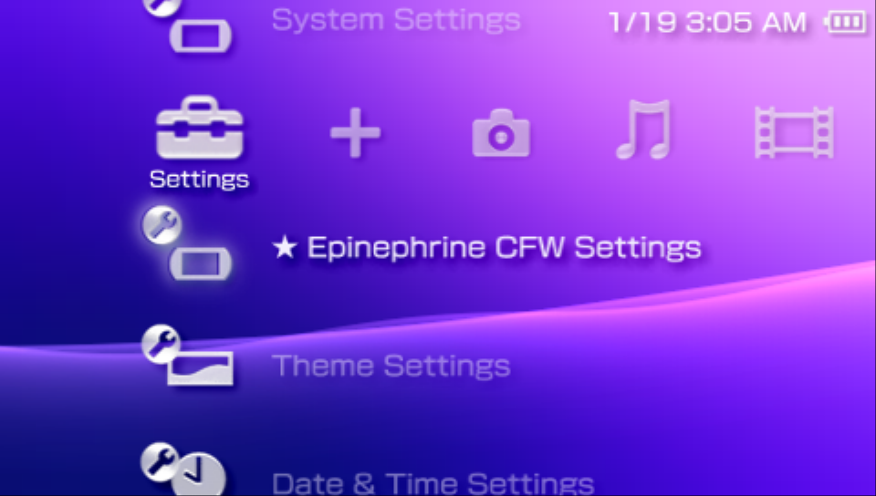
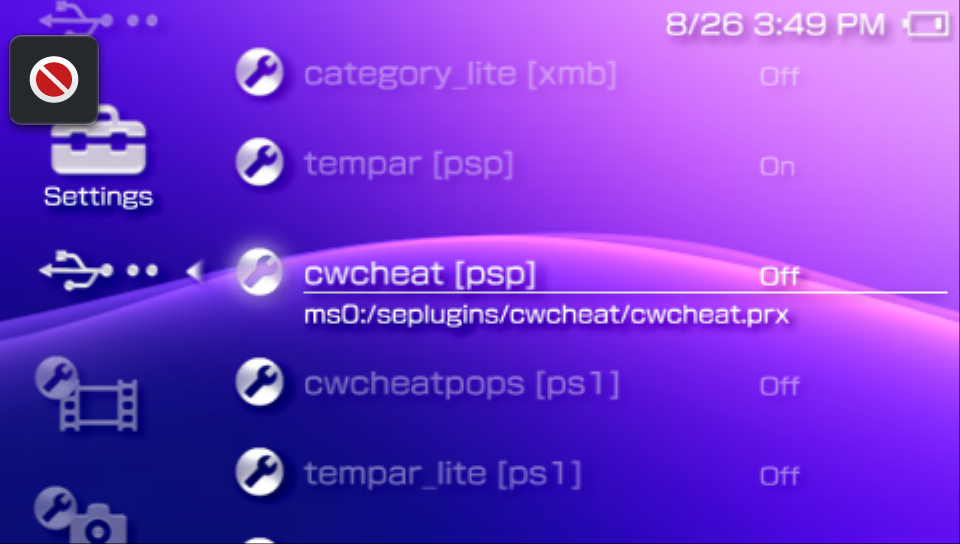
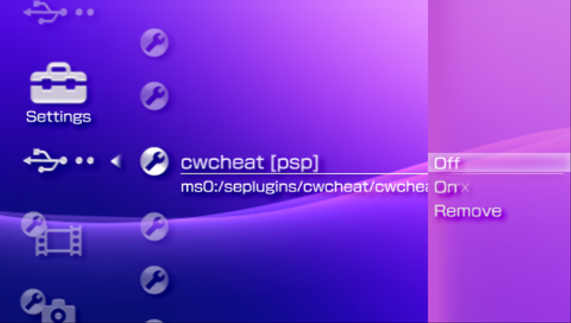

# XMB CFW Menus
---

Epinephrine adds extra menus to the XMB that allow the user to change CFW settings and work as a plugin manager.

## ★ Epinephrine CFW settings
---

This menu can be found in the `Settings` section of the XMB. It allows modifying the [Epinephrine CFW Settings](./08-CfwConfiguration.md).

Some options may require that the system be restarted before taking effect. This will be informed in the menu (third image).

Advanced settings are marked with the `▲` symbol at the start.

## ★ Plugins Manager
---

This menu can be found in the `Settings` section of the XMB. It allows modifying the [plugin configuration](./04-HomebrewSupport/02-PluginConfigFormat.md) directly from the XMB.

Once opened, it will show the list of plugins, their runlevels, and their path. Clicking the enter button allows to select the state of the plugin entry (`On`, `Off`, `Remove`).

The `Remove` option will remove the configuration line related to the plugin configuration file and restart the XMB.

## ★ Time Machine
---

This menu can be found in the `Settings` section of the XMB. It allows to load entire PSPemu firmware and CFW on Memory Stick. If no launchers are found, the menu item will auto-hidden.

Once opened, it will show the list of found launchers for specific PSPemu firmware and CFW.

The launchers can be found [here](https://github.com/PSP-Arkfive/TimeMachine/tree/main/vPSP).

> [!WARN]
> Currently we only support ARK on 6.61.

